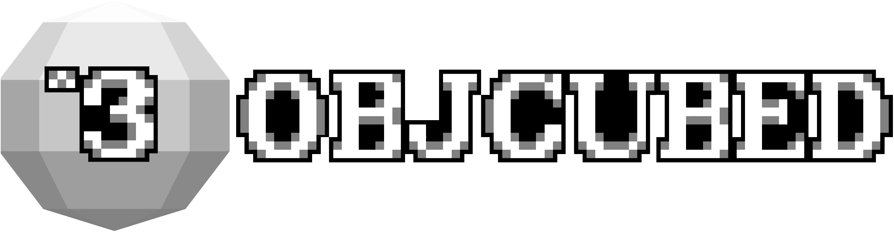

<h1 align="center"></h1>

[English](#english) · [Русский](#русский)

## English

Mesh models, 3D armor and first- and third-person animations in vanilla Minecraft.
Create and export them directly from [Blockbench](https://www.blockbench.net/).
No mods required.

[**Stable release 26.3v4**](https://github.com/JagerMeistars/obj-cubed/releases/tag/26.3v4) includes player skins, datapack controls for animated textures and whole-model shading.
[Skin setup and limitations](docs/PLAYER_SKIN_TEST_EN.md).

### What you can make

- Mesh models for items and blocks.
- 3D armor that follows the player's head, body and limbs.
- Model animations in your hands, visible in first and third person.
- Animal armor, saddles, blankets, harnesses and elytra, with templates to start from.
- Animated textures, including multiple animated textures in an atlas.
- Glowing details and models you can tint or animate with commands.

The plugin has English and Russian interfaces. This release is for **Minecraft
26.3** and **desktop Blockbench 4.8+**. For earlier Minecraft versions, use the
[corresponding release](https://github.com/JagerMeistars/obj-cubed/releases).

### Start

1. Download the [Blockbench plugin (`objcubed.js`)](https://github.com/JagerMeistars/obj-cubed/releases/download/26.3v4/objcubed.js) and load it via **File → Plugins → Load Plugin from File**.
2. Download the [resource pack (`objcubed.zip`)](https://github.com/JagerMeistars/obj-cubed/releases/download/26.3v4/objcubed.zip), put it in Minecraft's `resourcepacks` folder and enable it.
3. [Set up a model resource pack](docs/GUIDE_EN.md#set-up-a-model-resource-pack), open your model and choose **File → Export → Export as obj³…**.
4. Enable your model pack, reload resources with **F3+T** and use the command from the exported `_give.txt` file.

### Guides

- [Modeling, export and animation controls](docs/GUIDE_EN.md)
- [Animal equipment and elytra bindings (RU)](docs/ANIMAL_EQUIPMENT_RU.md)
- [Blockbench equipment templates (RU)](templates/animal-equipment/README-RU.md)
- [26.3v4 release notes](docs/RELEASE_26.3v4.md) and [verification](docs/VERIFICATION_26.3v4.md)

[Report a bug](https://github.com/JagerMeistars/obj-cubed/issues).

## Русский

Меши, 3D-броня и анимации от первого и третьего лица в vanilla Minecraft.
Создавайте и экспортируйте их прямо из [Blockbench](https://www.blockbench.net/).
Моды не нужны.

[**Стабильный релиз 26.3v4**](https://github.com/JagerMeistars/obj-cubed/releases/tag/26.3v4) поддерживает скины игроков, управление анимированными текстурами через датапак и выбор режима затенения для всей модели.
[Настройка скинов и ограничения](docs/PLAYER_SKIN_TEST_RU.md).

### Что можно сделать

- Модели предметов и блоков из мешей.
- 3D-броню, которая двигается вместе с головой, телом и конечностями игрока.
- Анимации моделей в руках от первого и третьего лица.
- Броню мобов, сёдла, попоны, упряжь и элитры; для начала есть готовые шаблоны.
- Анимированные текстуры, включая несколько анимированных текстур в атласе.
- Светящиеся детали, окрашивание моделей и управление анимацией через команды.

Интерфейс плагина доступен на русском и английском. Эта версия предназначена для
**Minecraft 26.3** и **настольного Blockbench 4.8+**. Для предыдущих версий Minecraft
выберите [соответствующий релиз](https://github.com/JagerMeistars/obj-cubed/releases).

### Начать

1. Скачайте [плагин Blockbench (`objcubed.js`)](https://github.com/JagerMeistars/obj-cubed/releases/download/26.3v4/objcubed.js) и установите его через **File → Plugins → Load Plugin from File**.
2. Скачайте [ресурспак (`objcubed.zip`)](https://github.com/JagerMeistars/obj-cubed/releases/download/26.3v4/objcubed.zip), положите его в папку `resourcepacks` Minecraft и включите в игре.
3. [Подготовьте ресурс-пак для моделей](docs/README_RU.md#установка), откройте модель и выберите **File → Export → Export as obj³…**.
4. Включите пакет модели, перезагрузите ресурсы через **F3+T** и используйте команду из экспортированного `_give.txt`.

### Руководства

- [Установка и обновление](docs/README_RU.md)
- [Привязки экипировки мобов и элитр](docs/ANIMAL_EQUIPMENT_RU.md)
- [Шаблоны экипировки для Blockbench](templates/animal-equipment/README-RU.md)
- [Изменения в 26.3v4](docs/RELEASE_26.3v4.md) и [результаты проверок](docs/VERIFICATION_26.3v4.md)

[Сообщить об ошибке](https://github.com/JagerMeistars/obj-cubed/issues).

---

**[Godlander](https://github.com/Godlander)** — original [objmc](https://github.com/Godlander/objmc)
concept, tool and core shaders / автор идеи, инструмента и core-шейдеров objmc,
на которых основан objcubed.

**[JagerMeistars](https://github.com/JagerMeistars)** — author of the objcubed
Blockbench plugin / автор плагина objcubed для Blockbench.

[Full credits](docs/GUIDE_EN.md#credits) · [MIT License](LICENSE).
